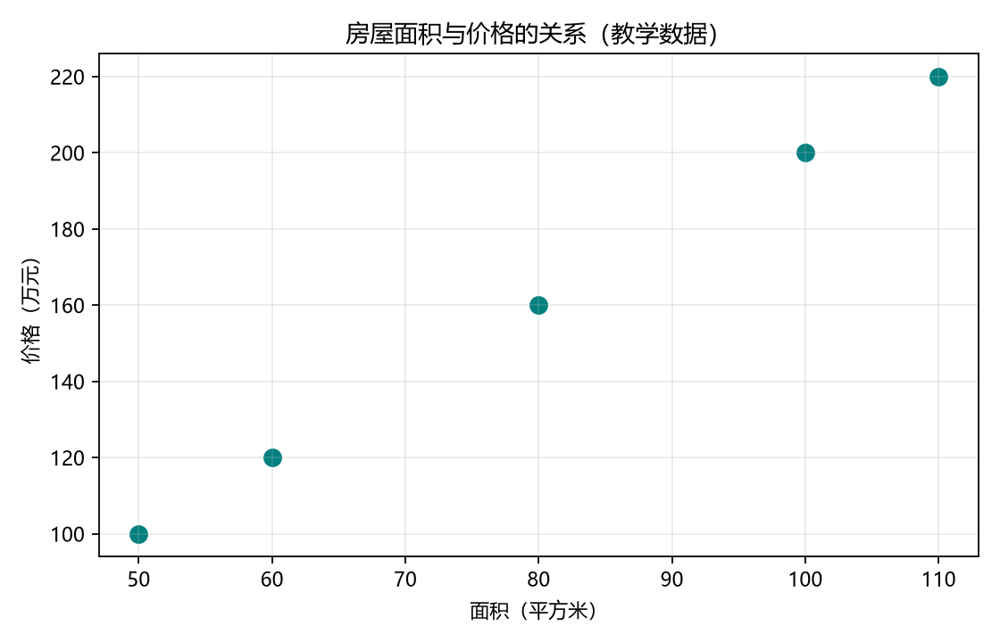

# 第 03 课：散点图

[返回课程索引](../../README.md) · [查看代码](lesson.py) · [上一课](../02_数据筛选/README.md) · [下一课](../04_线性回归/README.md)

## 本课目标

用图观察面积与价格的关系。Matplotlib 是 Python 的绘图库，`plt` 是这里使用的简称。

## 核心代码

```python
plt.scatter(df["面积"], df["价格"], color="teal", s=70)
```

`scatter` 表示画散点图。第一个参数决定横坐标，第二个参数决定纵坐标。
同一行中的面积与价格组合成一个点。`color` 设置颜色，`s` 设置点的大小。

- 横轴“面积（平方米）”：面积，单位为平方米。
- 纵轴“价格（万元）”：价格，单位为万元。
- 五个点分别表示五套房屋。
- 点 `(80, 160)` 表示面积 80 平方米、价格 160 万元的房屋。

其他代码用于设置尺寸、坐标轴名称、标题和网格，并将图像保存为 PNG。
图像固定保存在本课目录的 `outputs/area_price.png`，与运行时工作目录无关。
示例保存图片后结束，不会弹出绘图窗口。

## 已生成的图



这些虚构数据满足“价格 = 2 × 面积”，所以点排列在一条直线上。
真实房价还受位置、楼层、房龄等因素影响，通常不会排列得这么整齐。
这一课在观察关系，下一课才开始训练模型。
