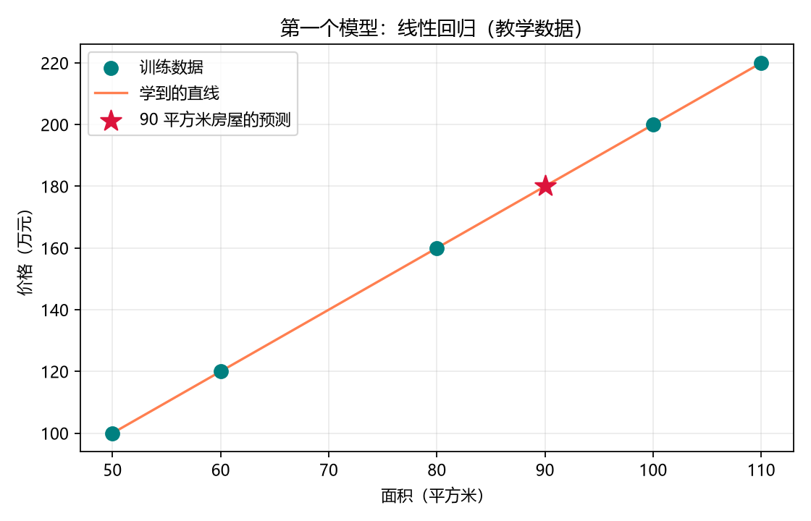

# 第 04 课：线性回归

[返回课程索引](../../README.md) · [查看代码](lesson.py) · [上一课](../03_散点图/README.md) · [下一课](../05_模型评估/README.md)

## 本课目标

训练第一个机器学习模型，预测 90 平方米房屋的价格。
本课使用 scikit-learn，安装时叫 `scikit-learn`，代码导入时叫 `sklearn`。

线性回归用一条直线描述输入与输出之间的关系。先选择这种公式形式：

```text
价格 = 系数 × 面积 + 截距
```

模型根据已有的面积与价格计算出合适的系数和截距，使平方误差之和尽可能小。
平方误差就是预测价格与实际价格之差的平方，本课暂不展开计算细节。

## 核心代码

```python
X = df[["面积"]]
y = df["价格"]
model = LinearRegression()
model.fit(X, y)
new_house = pd.DataFrame({"面积": [90]})
predicted_price = model.predict(new_house)[0]
```

- `X`：输入特征，即面积。双层方括号保留表格形式，形状为 `(5, 1)`，表示五个样本、一个特征。
- `y`：已知答案，也叫标签，即价格。
- `LinearRegression()`：创建模型。
- `fit(X, y)`：训练，计算模型参数。
- `predict(new_house)`：使用训练得到的参数预测。`[0]` 取出第一套房屋的预测结果。

## 已验证结果

```text
系数：2.0000
截距：0.0000
90 平方米的预测价格：180.00 万元
```

系数和截距来自训练计算，代码没有直接把“价格 = 2 × 面积”当作预测规则。
由于浮点数运算，内部数值可能有极小偏差，输出做了小数位格式化。



青色点是训练数据，橙色直线是学到的关系，红色星形点是 90 平方米的预测。
图片保存在本课的 `outputs/linear_regression.png`。

训练得到参数，预测使用参数。本例数据少且关系完全规则，下一课学习检查预测效果。
