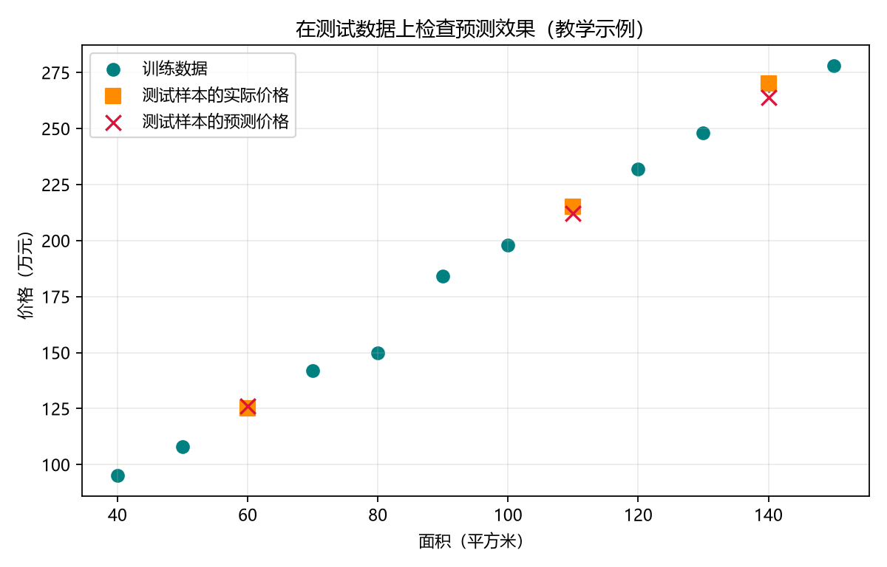

# 第 05 课：模型评估

[返回课程索引](../../README.md) · [查看代码](lesson.py) · [上一课](../04_线性回归/README.md) · [下一课](../06_过拟合/README.md)

## 本课目标

检查模型预测得好不好。本课改用 12 套虚构房屋，价格与面积大致相关，但关系不再完全规则。

- 训练集：9 套房屋，用于学习，相当于练习题。
- 测试集：3 套房屋，用于检查效果，相当于考试题。
- 测试时模型只收到面积，代码在预测后使用实际价格计算误差。

## 核心流程

```python
X_train, X_test, y_train, y_test = train_test_split(
    X, y, test_size=0.25, random_state=7
)
model.fit(X_train, y_train)
predictions = model.predict(X_test)
mae = mean_absolute_error(y_test, predictions)
```

`test_size=0.25` 表示留出 25% 的样本用于测试。
`random_state=7` 固定随机划分结果，方便重复运行时得到相同的教学结果；7 本身没有特殊含义。
输入面积与对应价格会一起划分，配对关系不会改变。

## 平均绝对误差 MAE

对每套测试房屋，先计算预测价格与实际价格相差多少，再求这些差的平均值。
取绝对值可以避免高估和低估相互抵消。例如预测 180 万元、实际 190 万元，绝对误差是 10 万元。

本例的 MAE 单位是万元，值越小，代表这批测试数据上的平均绝对误差越小。
它不是百分比，单套房屋的误差可能大于或小于平均值。

## 已验证结果

下表价格与误差的单位均为万元：

| 面积（平方米） | 实际价格 | 预测价格 | 绝对误差 |
| --- | ---: | ---: | ---: |
| 60 | 125 | 126.25 | 1.25 |
| 110 | 215 | 212.24 | 2.76 |
| 140 | 270 | 263.83 | 6.17 |

还需要一个简单的比较对象：每套房屋都猜训练集平均价格。平均价格只从训练集计算。
代码用相同的测试集评估模型和这个简单基准。

| 方法 | 测试集 MAE（万元） |
| --- | ---: |
| 每次猜训练集平均价格 | 59.44 |
| 线性回归 | 3.39 |



青色圆点是训练样本，橙色方块是测试答案，红色叉号是预测值。
答案与预测之间的竖向虚线表示该样本的绝对误差。
图片保存在本课的 `outputs/model_evaluation.png`。

这是小规模虚构数据上的演示，真实应用还需要更多有代表性的数据。
反复根据同一测试集修改模型，会削弱它作为独立检查的作用。
下一课学习过拟合：为什么练习题做得好，新题却可能做得差。
