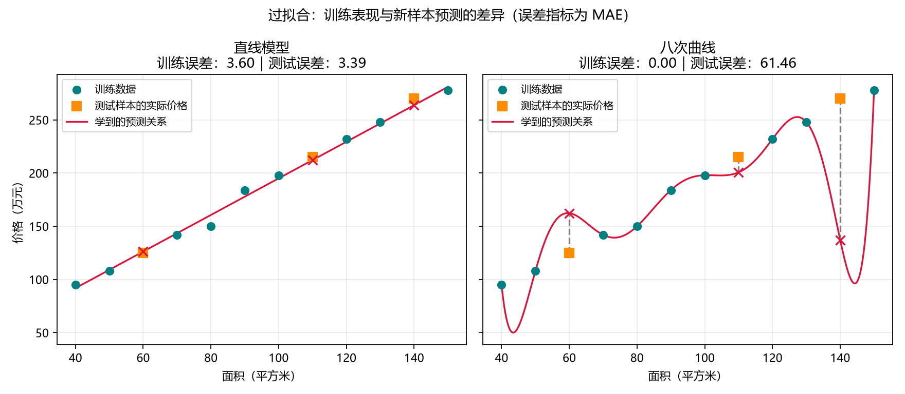

# 第 06 课：过拟合

[返回课程索引](../../README.md) · [查看代码](lesson.py) · [上一课](../05_模型评估/README.md) · [下一课](../07_分类入门/README.md)

## 本课问题

上一课用测试数据检查模型效果。这一课进一步问：训练题做得越好，模型就一定越好吗？

想象一个学生记住了练习题的答案，但题目稍微变化就不会做。
模型也可能过度迎合训练数据中的细节和偶然变化，在训练集上表现很好，在新样本上表现较差。
这种现象叫**过拟合（overfitting）**。
对未用于训练的新样本也能做出合理预测的能力，叫**泛化能力（generalization）**。

## 比较两个模型

继续使用第五课的 12 套虚构房屋数据，以及相同的 9 套训练样本和 3 套测试样本。
两个模型接收完全相同的输入和已知答案，使用同一个 MAE 指标。

- 直线模型：允许调整系数和截距，共两个参数。
- 八次多项式曲线：可以利用输入的一次方、平方、立方直到八次方组合成曲线，连同截距有九个参数，形状更加灵活。

曲线有更大的自由度，能够贴合训练数据中的细节；这些细节未必适用于新数据。
复杂模型也可能学到有用关系，是否过拟合需要结合训练和新样本的表现判断。

## 核心代码

```python
simple_model = LinearRegression()
complex_model = make_pipeline(
    StandardScaler(),
    PolynomialFeatures(degree=8, include_bias=False),
    LinearRegression(),
)
```

- `PolynomialFeatures(degree=8)` 允许利用最高八次方的特征，增加曲线的灵活性。
- `StandardScaler()` 缩放输入数值，帮助高次方计算保持稳定，具体数学后续再讲。
- `make_pipeline(...)` 将缩放、特征展开和回归连接成一个处理流程。
- 两个模型都通过 `fit(X_train, y_train)` 学习。曲线的形状与参数由训练计算得到。
- 流程中的缩放参数和回归参数只从训练集获得，不使用测试集学习。

本课先理解过拟合现象，无需立刻掌握多项式与处理流程的全部数学。
绘图中的 `np.linspace(40, 150, 400)` 生成一组密集面积，用来把预测关系画成平滑的线。

## 实际运行结果

MAE 的单位均为万元：

| 模型 | 训练集 MAE | 测试集 MAE |
| --- | ---: | ---: |
| 直线 | 3.60 | 3.39 |
| 八次曲线 | 约 0.00 | 61.46 |

曲线的训练误差约为 `1.9 × 10^-12`，显示为 0.00 是保留两位小数的结果。
它几乎通过全部九个训练点，但测试结果明显变差。

测试预测如下，价格单位均为万元：

| 面积（平方米） | 已知价格 | 直线预测 | 八次曲线预测 |
| --- | ---: | ---: | ---: |
| 60 | 125 | 126.25 | 162.32 |
| 110 | 215 | 212.24 | 200.74 |
| 140 | 270 | 263.83 | 137.20 |

例如，140 平方米房屋的已知价格为 270 万元，复杂曲线却预测约 137.20 万元。
训练表现好，不能单独证明对新样本的预测效果好。

## 看图理解



- 左图是直线，右图是八次曲线，两图使用相同的坐标范围。
- 青色圆点是训练样本，橙色方块是测试样本的已知价格。
- 红色线是模型学到的预测关系，红色叉号是测试样本的预测。
- 灰色竖向虚线表示预测与答案的差距。

观察右图：曲线穿过训练点，却在点之间出现明显的弯折，特别是在面积 140 平方米附近。
图像保存在本课的 `outputs/overfitting.png`。

## 发现过拟合之后

可考虑增加有代表性的训练数据、降低不必要的模型复杂度，或限制参数过度变化。
这些方法的具体使用会在后续课程按需要展开，不能保证每次都有效。
训练数据中包含真实曲线关系时，过于简单的模型也可能学不好，称为欠拟合，后续再详细比较。

本课固定两个模型进行教学对比。实际调模型时通常再划出验证集，用于选择模型或参数，测试集留到最后检查。
反复根据同一个测试集尝试不同模型后，就不能把它当作完全独立的最终评价。
本例是小规模虚构数据，用于展示现象，不能据此断言所有复杂模型都比简单模型差。

## 理解检查（附答案）

模型 A：训练误差几乎为零，新题误差很大。
模型 B：训练误差略大，新题误差较小。
如果关注新题表现，本例中更倾向哪个模型？为什么？

参考答案：B，因为我们关注泛化能力。A 的表现提示过拟合，不能只根据训练误差选择模型。

下一课学习分类：从预测数字转向预测类别。
