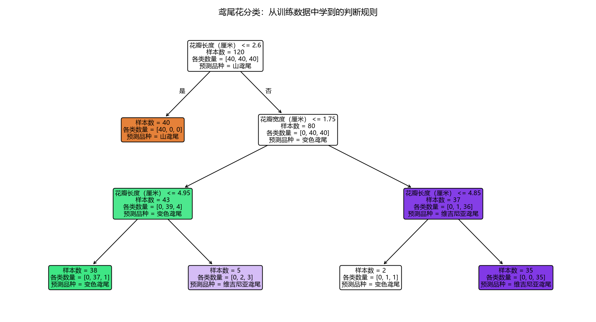

# 第 07 课：分类入门

[返回课程索引](../../README.md) · [查看代码](lesson.py) · [上一课](../06_过拟合/README.md) · [下一课](../08_神经网络入门/README.md)

## 本课问题

前面根据面积预测价格，输出一个数值。这次根据花的测量数据判断它属于哪个品种，输出一个类别。

| 任务 | 想得到的答案 | 类型 |
| --- | --- | --- |
| 预测房价 | 180 万元等数值 | 回归（regression） |
| 判断花的品种 | 某个品种名称 | 分类（classification） |
| 判断邮件是否为垃圾邮件 | 垃圾邮件或普通邮件 | 分类 |

类别也可以用数字编码，但这些数字表示名称，不表示大小或价格。

## 数据与特征

使用 scikit-learn 自带的 Iris 鸢尾花数据集，包含 150 个真实测量样本、三个品种，每个品种 50 个样本。
通过 `load_iris(as_frame=True)` 读取，数据随已安装的库提供，无需联网下载。
数据说明见 [scikit-learn 官方资料](https://scikit-learn.org/stable/datasets/toy_dataset.html#iris-dataset)。

每一行是一朵花，输入包含四个特征，单位都是厘米：

| 课程中的中文列名 | 数据集原始字段 |
| --- | --- |
| `花萼长度（厘米）` | `sepal length (cm)` |
| `花萼宽度（厘米）` | `sepal width (cm)` |
| `花瓣长度（厘米）` | `petal length (cm)` |
| `花瓣宽度（厘米）` | `petal width (cm)` |

花萼是花瓣外侧的结构，花瓣是花的组成部分。这些长度与宽度是模型识别品种的依据。
这次 `X` 有四列，说明一个样本可以同时提供多个输入特征。

示例为四个测量特征设置中文列名，输出的品种名称也使用中文。标签 `y` 使用如下编码：

| 编码 | 中文名称 | 数据集中的名称 |
| --- | --- | --- |
| 0 | 山鸢尾 | setosa |
| 1 | 变色鸢尾 | versicolor |
| 2 | 维吉尼亚鸢尾 | virginica |

可以把这三个名称理解为品种 A、B、C。编码 2 不代表比编码 1 更大、更贵或更好。

## 模型：决策树

决策树（decision tree）像一个逐步判断的流程：先检查一个特征，再沿不同分支继续判断，最终到达一个品种。
特征的选择与判断阈值由训练计算得到。
本课预先设置最多连续三次判断，限制模型复杂度，承接上一课对过拟合的讨论。

```python
X = iris.data.copy()
X.columns = ["花萼长度（厘米）", "花萼宽度（厘米）", "花瓣长度（厘米）", "花瓣宽度（厘米）"]
y = iris.target
X_train, X_test, y_train, y_test = train_test_split(
    X, y, test_size=0.2, random_state=7, stratify=y
)
model = DecisionTreeClassifier(max_depth=3, random_state=7)
model.fit(X_train, y_train)
predictions = model.predict(X_test)
accuracy = accuracy_score(y_test, predictions)
```

- `test_size=0.2`：120 个样本用于训练，30 个样本留作测试。
- `stratify=y`：划分时保持三个品种的比例。本例每个品种有 40 个训练样本、10 个测试样本。
- `random_state=7`：固定随机过程，便于复现结果。
- `fit` 依然是训练，`predict` 依然是预测，只是现在返回类别编码。

这组设置事先固定，代码不会根据测试结果反复选择树的深度。

## 分类怎样评估

准确率（accuracy）表示：预测正确的数量除以测试样本总数。
本课用它衡量品种判断的正确比例；类别编码之间的数值差没有自然的距离含义，所以不沿用房价示例的 MAE。

实际运行结果：

```text
测试样本：30 个
判断正确：29 个
准确率：29 ÷ 30 ≈ 96.67%
每次猜同一品种的基准准确率：33.33%
```

训练集中三个品种数量相同，基准在并列的最多类别中固定选择一个；测试集中每个品种有 10 朵，因此猜对 10 个。
96.67% 是这一次测试划分的结果，不能理解为以后每批数据都必然达到这个比例。

程序同时打印判断错误的样本：索引为 126 的样本，已知品种是维吉尼亚鸢尾，预测为变色鸢尾。
它的花萼长宽是 6.2、2.8 厘米，花瓣长宽是 4.8、1.8 厘米。
实际类别来自测试答案，只用于评估，没有参与训练。

## 看懂模型学到的规则



从最上方开始读。第一条判断是花瓣长度是否小于或等于 2.60 厘米：

- 满足条件走左分支，本模型判为山鸢尾。
- 不满足条件走右分支，继续检查花瓣宽度等信息。
- 一直沿判断走到末端节点，得到最终品种。

图中“样本数”是到达该节点的训练样本数量，“各类数量”依次表示三个品种的训练样本数量。
“预测品种”是该节点的多数类别；内部节点仍要继续判断，末端节点的类别才是该条路径的预测。
最多类别并列时会固定选择一个，所以根节点显示的品种不是对所有输入的最终答案。

例如错误样本的花瓣长为 4.8、宽为 1.8，沿右侧分支最终到达变色鸢尾节点；这是模型的预测规则，不一定等于真实品种。
图片保存在本课的 `outputs/decision_tree.png`。

## 准确率的适用范围

本例三个品种数量相同，准确率能直观展示整体表现。
如果 100 封邮件中有 99 封普通邮件，只猜普通邮件也能达到 99% 准确率，却找不出那一封垃圾邮件。
因此类别严重不平衡时，还需要查看各类别的错误情况和其他指标，后续再展开。

## 理解检查（附答案）

预测明天温度是回归还是分类？预测明天是否下雨呢？

参考答案：预测温度数值是回归；预测是否下雨是分类，因为答案是两个类别之一。
如果目标改为温度所属的高、中、低档位，则变成分类。任务类型取决于希望输出什么。

下一课学习[神经网络入门](../08_神经网络入门/README.md)：神经元、权重与偏置。
