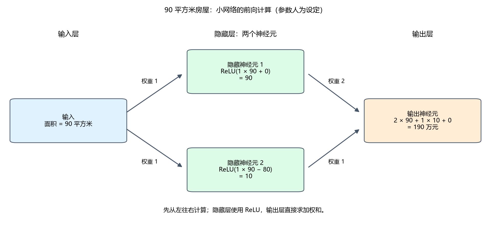
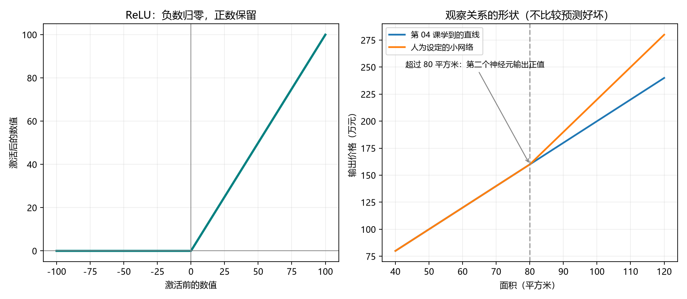

# 第 08 课：神经网络入门

[返回课程索引](../../README.md) · [查看代码](lesson.py) · [上一课](../07_分类入门/README.md)

## 本课问题

前面已经接触回归、分类和评估。现在开始打开模型内部，看看“神经网络”到底怎样计算。
本课继续用房价这个数值输出的例子，先理解神经元、权重、偏置、隐藏层和激活函数。
模型也可以用于分类，输出方式会在后续展开。

你不用手敲代码。先阅读本页的计算例子，再查看 `lesson.py` 和两张已生成的图片。
这里的房屋数据和定价规则均为虚构教学示例。

## 从已经见过的直线开始

第 04 课训练后得到：

```text
价格 = 2 × 面积 + 0
90 平方米的预测价格 = 2 × 90 + 0 = 180 万元
```

换一组名称，这个计算就是一个最简单的**线性神经元**：

```text
输出 = 权重 × 输入 + 偏置
```

| 名称 | 本例中的数值 | 含义 |
| --- | --- | --- |
| 输入 | 面积 90 | 交给模型的信息 |
| 权重（weight） | 2 | 输入乘上的系数 |
| 偏置（bias） | 0 | 乘法完成后额外加上的数 |
| 输出 | 价格 180 | 本次计算结果 |

神经元可以先理解为一个小计算单元；人工神经网络借用了这个名称，具体操作是数学计算。
一个神经元也可以接收多个输入：每个输入乘自己的权重，再把结果相加，最后加偏置。

例如，先人为指定权重为 2、偏置为 10，同样输入 90，输出会变成 `2 × 90 + 10 = 190`。
权重控制输入的影响，偏置让整条直线整体上移或下移。
这里的数字只是解释参数含义；代码第一段仍会用第 04 课的数据，通过训练得到权重 2、偏置 0。

## 模型结构和训练得到的参数

在第 04 课，程序通过下面的调用学习：

```python
model.fit(df[["面积"]], df["价格"])
weight = float(model.coef_[0])
bias = float(model.intercept_)
```

我们选择“用直线表示面积与价格的关系”，库负责根据输入和已知价格计算系数与截距。
也就是说，**模型的形式由我们选择，参数可以通过训练得到**。

有了参数，做一次预测只需要：

```python
def linear_neuron(x, weight, bias):
    return weight * x + bias
```

`x` 是一个输入；`weight` 和 `bias` 决定怎样计算；函数返回一个输出。
本课手写这个计算得到 180 万元，与 `model.predict(...)` 的实际结果一致。

## 激活函数：在乘加之后再做一步处理

很多神经元会在加权求和之后再接一个**激活函数（activation function）**。
它接收一个数，再按规则输出一个数。本课只认识常用的 ReLU：

```python
def relu(z):
    return max(0, z)
```

`z` 就是乘加计算得到的数。ReLU 把负数变成零，零和正数保持原值：

| 激活前 | 激活后 |
| ---: | ---: |
| -10 | 0 |
| 0 | 0 |
| 10 | 10 |

如果只把若干个线性乘加步骤连接起来，整体仍是线性关系。
加入 ReLU 这样的非线性激活函数后，网络可以表达带转折的关系。
“激活”是这个数值处理步骤的名字，不表示程序具有意识。

## 把神经元连接成一个小网络

现在人为搭建一个小网络：一个输入，两个隐藏神经元，一个输出神经元。
中间一层叫**隐藏层（hidden layer）**，因为它的数值是中间结果；我们当然可以打印出来查看。

为了让每一步都看得清楚，**这一段的参数由我们设定，尚未训练**：

```python
hidden_1 = relu(1 * area + 0)
hidden_2 = relu(1 * area - 80)
price = 2 * hidden_1 + 1 * hidden_2 + 0
```

对本例的正数面积，两个隐藏神经元分别计算：

- 第一个：保留整套房屋的面积。
- 第二个：只保留超过 80 平方米的部分；不超过 80 时输出零。

输出层把两个结果组合起来。人为规定的定价规则是：每平方米 2 万元，超过 80 平方米的部分每平方米额外 1 万元。
本例属于回归，输出层直接返回价格，没有再使用 ReLU；不同任务的输出层可以采用不同处理方式。

90 平方米时，按顺序计算：

```text
隐藏神经元 1：ReLU(90) = 90
隐藏神经元 2：ReLU(90 − 80) = ReLU(10) = 10
输出价格：2 × 90 + 1 × 10 + 0 = 190 万元
```



图从左往右读：输入层提供面积，隐藏层生成两个中间数，输出层组合得到价格。
箭头旁的数字表示权重，框内展示乘加和激活的结果。
这些中间含义是我们特意设计出来的；实际训练的网络中，每个神经元未必有这样清晰的生活含义。

## 实际运行结果

示例已经实际运行。第一段训练得到权重 2.00、偏置 0.00，90 平方米输出 180.00 万元。
人为设定的小网络则输出：

| 面积（平方米） | 隐藏神经元 1 | 隐藏神经元 2 | 网络输出（万元） |
| ---: | ---: | ---: | ---: |
| 70 | 70 | 0 | 140 |
| 90 | 90 | 10 | 190 |
| 100 | 100 | 20 | 220 |

70 平方米时，第二个神经元先计算 `70 - 80 = -10`，经过 ReLU 后得到零。
所以它在这一套房屋的输出中没有增加价格。



- 左图：横轴是激活前的数，纵轴是 ReLU 处理后的数。负数一侧输出都为零。
- 右图：横轴是面积，纵轴是输出价格。小网络的线在 80 平方米处发生转折。

两条线展示的是模型形式的差异。小网络没有在测试集上评估，不能根据它输出更高的价格就判断它更准确。
下一步仍需要连接之前学过的评估方法，用未参与训练的数据检查实际效果。

## 前向传播与训练

输入面积，从左往右计算出价格，这一次过程叫**前向传播（forward propagation）**。

训练时，还要用训练样本的已知答案检查预测误差，并按训练方法调整权重和偏置。
前向传播是计算预测值的步骤；单独做一次前向传播不会自动改变参数。
本课第一段的参数通过 `fit` 获得，第二段的小网络仅演示前向计算。

之后我们会用 PyTorch 来定义网络和计算，再学习怎样自动调整参数。
Transformer 也是神经网络的一种结构，认识这些基本计算单元是后续学习的起点。

## 理解检查（附答案）

1. 输入面积为 70 时，第二个隐藏神经元输出 -10 还是 0？
2. `price = 2 * hidden_1 + hidden_2` 计算了一次价格，参数是否就自动学好了？

参考答案：

1. 输出 0，因为 -10 经过 ReLU 后变成零。
2. 没有。这里只做了前向计算，训练还需要依据训练数据调整参数。

下一课学习损失函数：怎样把“预测错了多少”变成训练可以使用的一个数。
